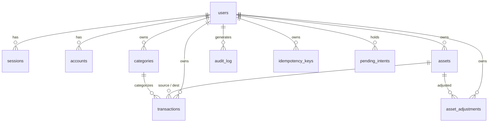

# Dokumentasi Sistem Fintry v1.0 (Current Running State)

Dokumentasi resmi kondisi implementasi sistem Fintry yang berjalan saat ini (MVP + Polish Stage). Dokumen ini mencakup seluruh fitur aktif, alur pengguna dari autentikasi hingga pencatatan transaksi, aturan domain, struktur database, hingga analisis identitas visual/warna aktual.

---

## 1. Ringkasan Eksekutif & Karakteristik Sistem

Fintry v1.0 adalah aplikasi pencatatan dan pemantauan keuangan pribadi berbasis web yang mengutamakan kecepatan pencatatan transaksi melalui antarmuka obrolan bahasa alami (Natural Language Chat), dipadukan dengan mesin finansial deterministik yang ketat dan aman.

- **Status Rilis**: v1.0 MVP Selesai (Production-Ready).
- **Pendekatan Arsitektur**: Layered Architecture (Clean/DDD).
  - `Presentation` (Next.js App Router, React Components, Server Actions).
  - `Application` (Services, Command Handlers, Chat Orchestrator, Parser).
  - `Domain` (Financial Calculation, Accounting Engine, Category Rules, Money Types).
  - `Infrastructure` (Database Drizzle ORM, PostgreSQL Node-Postgres Driver, Better Auth Adapter, Resend).
- **Prinsip AI Boundary**:
  - LLM/Parser bertindak sebagai adapter ekstraksi informasi tanpa otoritas mutasi data.
  - Alur eksekusi: `User Input → Chat → Parser (Intent) → Validator → Financial Engine → Database (Atomic Transaction) → Dashboard Update`.

---

## 2. Tech Stack & Dependensi Utama

| Lapisan / Komponen | Teknologi & Versi | Peran |
| :--- | :--- | :--- |
| **Framework Web** | Next.js 16.3.8 (App Router) | Fullstack framework, SSR, Server Actions, API routes |
| **Bahasa Pemrograman** | TypeScript 5, Node.js 24 | Static typing end-to-end |
| **Styling & UI** | Tailwind CSS v4, shadcn/ui, Lucide Icons | Styling sistem utilitas & komponen dasar |
| **Autentikasi** | Better Auth 1.7.7 | Session berbasis database, hashing credential, rate limit |
| **Database & ORM** | PostgreSQL, Drizzle ORM 0.45.3, `pg` driver | Relational persistence, migrasi terkelola Drizzle Kit |
| **Email Service** | Resend 6.34.1 | Pengiriman email reset password dan verifikasi |
| **Validasi & Parsing** | Zod 4.6.5, Custom Rule Extractor | Validasi skema input & normalisasi intent finansial |
| **Pengujian (Tests)** | Vitest 5.0.3, Fast-Check, Playwright 1.63 | 70 unit/integration tests + 7 E2E specs |

---

## 3. Invarian Finansial & Aturan Bisnis (Domain Rules)

1. **Format Mata Uang**: Seluruh nilai uang disimpan dalam format integer `BIGINT` (Rupiah satuan terkecil). Tidak ada representasi desimal `FLOAT` untuk mencegah floating-point rounding error.
2. **Saldo Non-Negatif**: Saldo aset tidak boleh menjadi negatif. Transaksi pengeluaran atau transfer yang melebihi saldo akun akan ditolak secara deterministik.
3. **Immutability & Reversal**:
   - Penghapusan fisik data transaksi finansial dilarang (`no physical delete`).
   - Pembatalan transaksi menggunakan status `VOIDED`.
   - Modifikasi terhadap nilai uang, jenis transaksi, atau akun sumber/tujuan dilakukan melalui mekanisme atomic VOID + penggantian (`replaces_transaction_id`).
   - Pengeditan langsung hanya diizinkan untuk kolom non-finansial: `description`, `category_id`, dan `transaction_date`.
4. **Append-Only Adjustments**: Penyesuaian saldo awal (*opening balance*) dan penilaian aset (*valuation*) disimpan secara append-only di tabel `asset_adjustments`.
5. **Kategori Otomatis**: Kategori dibuat secara dinamis (*find-or-create*) per-pengguna melalui normalisasi teks Unicode (NFKC, trim, batas 1–40 karakter).
6. **Pending Intent Buffer**: Transaksi ambigu memiliki TTL 10 menit dan disimpan di tabel `pending_intents` untuk konfirmasi atau pelengkap dari pengguna.

---

## 4. Rincian Fitur Sistem Berjalan Saat Ini

### 4.1. Alur Autentikasi & Akun Pengguna

1. **Halaman Registrasi (`/register`)**:
   - Kolom form:
     - `Email`: Validasi format email standar.
     - `Password`: Minimal 8 karakter.
     - `Konfirmasi Password`: Harus sama persis dengan password.
   - Catatan teknis: Nama pengguna (`name`) diisi otomatis dari prefix email (`email.split("@")[0]`) sesuai ketetapan awal ADR-003.
   - Setelah sukses, pengguna langsung dialihkan ke dashboard utama (`/`).
2. **Halaman Login (`/login`)**:
   - Kolom form:
     - `Email` (input type email).
     - `Password` (input type password).
   - Tautan tambahan: "Lupa password?" mengarah ke `/forgot-password`.
   - Sesi disimpan secara aman di tabel `sessions` database dengan cookie HTTP-only.
3. **Alur Lupa & Reset Password (`/forgot-password` & `/reset-password`)**:
   - Input alamat email untuk meminta token reset password.
   - Mengirim tautan token reset via Resend API (atau output log konsol pada lingkungan pengembangan lokal).
   - Halaman `/reset-password` menerima token dan memperbarui password baru pengguna.
4. **Navigasi Profil & Manajemen Kredensial**:
   - Terletak di navbar dashboard kanan atas melalui komponen `ProfileDropdown`:
     - Tampilan email pengguna aktif.
     - Modal Ubah Password (`ChangePasswordDialog`).
     - Modal Ubah Email (`ChangeEmailDialog`).
     - Tombol Keluar / Logout (`LogoutButton`) yang menghapus sesi aktif.

---

### 4.2. Halaman Dashboard Utama (`/dashboard`)

Halaman sentral yang diakses pengguna setelah login, menampilkan informasi finansial secara komprehensif:

1. **Navbar Dashboard (`DashboardNavbar`)**:
   - Menampilkan logo/nama sistem "Fintry".
   - Indikator email pengguna aktif.
   - Tautan navigasi cepat ke halaman Riwayat Transaksi (`/dashboard/history`).
   - Menu dropdown profil pengguna.
2. **Ringkasan Kekayaan (Net Worth Summary)**:
   - Terdiri dari 3 kartu metrik horizontal:
     - **Kekayaan Bersih**: Total kalkulasi nilai seluruh aset aktif (Kas, Bank, E-Wallet, Investasi).
     - **Total Kas & Bank**: Akumulasi saldo aset likuid (Bank dan E-Wallet).
     - **Total Investasi**: Akumulasi nilai aset kategori investasi (Saham, Reksa Dana, Kripto, dll).
3. **Area Input Transaksi Natural via Chat (`ChatInput`)**:
   - Formulir obrolan satu kolom dengan tombol "Kirim".
   - Menerima kalimat natural, seperti:
     - *"beli kopi 25rb pake BCA"* (Pengeluaran).
     - *"gaji 5jt masuk ke BCA"* (Pemasukan).
     - *"transfer 500rb dari BCA ke GoPay"* (Transfer antar akun).
     - *"beli reksadana 1jt pake dana BCA"* (Pembelian investasi).
   - Memberikan respon balik interaktif: konfirmasi perubahan saldo atau permintaan klarifikasi jika parameter belum lengkap.
4. **Daftar Akun Aktif (`AssetList`)**:
   - Menampilkan daftar seluruh akun/aset yang dimiliki pengguna (Bank, E-Wallet, Investasi) beserta saldo terkini.
   - **Dialog Tambah Akun (`AddAssetDialog`)**: Tombol aksi langsung berada di dalam header kartu ini pada dashboard, memungkinkan penambahan nama akun, tipe aset, dan saldo awal secara instan.
5. **Riwayat Transaksi Terkini (`TransactionLedger`)**:
   - Menampilkan daftar 20 transaksi aktif terbaru.
   - Menampilkan jenis transaksi (badge warna), kategori, deskripsi, tanggal, dan nominal transaksi.
   - Terdapat tautan "Lihat semua →" yang mengarahkan ke halaman riwayat lengkap.

---

### 4.3. Halaman Riwayat Transaksi Lengkap (`/dashboard/history`)

Halaman audit dan pengelolaan transaksi tingkat lanjut:

1. **Filter Transaksi**:
   - Filter Jenis: `Semua`, `Masuk` (INCOME), `Keluar` (EXPENSE), `Transfer` (TRANSFER).
   - Filter Status: `Semua`, `Aktif` (ACTIVE), `Voided` (VOIDED).
2. **Paginasi Data**:
   - Pembagian data 20 transaksi per halaman dengan navigasi halaman sebelumnya dan berikutnya.
3. **Aksi Transaksi**:
   - **Edit Transaksi (`EditTransactionDialog`)**: Mengubah deskripsi, kategori, atau tanggal transaksi aktif.
   - **Void Transaksi (`VoidTransactionDialog`)**: Membatalkan transaksi aktif secara aman, memulihkan saldo akun yang bersangkutan, dan mencatat riwayat pembatalan ke audit log.

---

## 5. Analisis Desain UI, Tipografi & Skema Warna Saat Ini

### 5.1. Palet Warna Aktual pada Kode Sumber

Berbeda dengan konsep awal pada `README.md`, sistem v1.0 yang berjalan saat ini menggunakan tema **Neutral Monochrome (Tailwind Zinc)** standar:

| Elemen Antarmuka | Token / Kode Warna Aktual | Deskripsi Visual |
| :--- | :--- | :--- |
| **Background Halaman** | `bg-zinc-50` (`#FAFAFA`) | Latar belakang terang (Light mode bawaan) |
| **Card / Surface Container** | `bg-white` (`#FFFFFF`) | Permukaan kartu berwarna putih bersih |
| **Border / Garis Pemisah** | `border-zinc-200` (`#E4E4E7`) | Garis tepi abu-abu muda subtil |
| **Teks Primer** | `text-zinc-900` (`#18181B`) | Teks utama abu-abu sangat gelap |
| **Teks Sekunder / Muted** | `text-zinc-500` (`#71717A`) / `zinc-400` | Keterangan tambahan dan placeholder |
| **Tombol Utama (Primary)** | `bg-zinc-900` dengan teks putih | Tombol kontras hitam pekat |
| **Badge Pemasukan (Income)** | `bg-green-100 text-green-700` | Hijau lembut standar |
| **Badge Pengeluaran (Expense)**| `bg-red-100 text-red-700` | Merah muda standar |
| **Badge Transfer** | `bg-blue-100 text-blue-700` | Biru muda standar |

### 5.2. Status Dark Mode & Tema

- File `globals.css` telah mendefinisikan variabel CSS `.dark` (Zinc-950, Zinc-900, border Zinc-800).
- Namun, elemen akar (`<html>` pada `layout.tsx`) **tidak menetapkan class `dark` secara default**, dan belum tersedia toggle switch tema di UI.
- Akibatnya, sistem saat ini secara default tampil dalam mode terang (**Light Mode Zinc**).

### 5.3. Struktur Tata Letak (Layout Hierarchy)

- Tata letak dashboard saat ini adalah **Single Column Vertikal**:
  1. Header Bar (Full width).
  2. Summary Metric Cards (Grid 3 kolom).
  3. Chat Command Box (Satu kolom lebar).
  4. Lower Section (Grid 2 kolom: Daftar Akun di kiri, Riwayat Transaksi di kanan).
- Layout ini belum menerapkan sistem *Split-view* (Chat Terminal vertikal di kiri dan Master Dashboard di kanan) maupun *Sidebar Navigation*.

### 5.4. Tipografi

- Font Sans: **Geist Sans** digunakan untuk teks judul, metrik angka, label, dan isi tabel.
- Font Mono: **Geist Mono** telah dimuat pada layout sistem, namun input teks chat saat ini masih menggunakan font sans umum.

---

## 6. Struktur Database (Drizzle ORM Tables)

1. **`users`**: ID UUID, nama, email unik, status verifikasi email, timestamp.
2. **`sessions`**: Token sesi login, masa berlaku token, alamat IP, user agent, relasi ke user ID.
3. **`accounts`**: Provider OAuth dan relasi akun eksternal/password Better Auth.
4. **`verifications`**: Penyimpanan token verifikasi email dan reset sandi.
5. **`assets`**: ID UUID, tipe (`BANK`, `E_WALLET`, `INVESTMENT`), nama aset, saldo berjalan (`current_value`), status aktif (`is_active`).
6. **`asset_adjustments`**: Rekam append-only penyesuaian saldo (`OPENING_BALANCE`, `BALANCE_ADJUSTMENT`, `VALUATION`).
7. **`categories`**: Kategori transaksi per-pengguna (`INCOME` / `EXPENSE`).
8. **`transactions`**: ID UUID, tipe (`INCOME`, `EXPENSE`, `TRANSFER`), nominal BIGINT, tanggal, deskripsi, relasi aset asal & tujuan, relasi kategori, status (`ACTIVE`, `VOIDED`), referensi audit penggantian (`replaces_transaction_id`).
9. **`audit_log`**: Catatan jejak audit perubahan status transaksi dan saldo.
10. **`idempotency_keys`**: Mencegah duplikasi eksekusi request transaksi finansial.
11. **`pending_intents`**: Penyimpanan intent obrolan yang belum tuntas dengan TTL 10 menit.

---

## 7. Status Pengujian & Verifikasi

- **Unit & Integration Tests**: 70 uji lulus.
  - Domain Accounting & Money: 19 skenario.
  - Repositories & Locking: 13 skenario.
  - Application Commands: 13 skenario.
  - Application Services: 8 skenario.
  - Parser & Schemas: 10 skenario.
  - Chat Orchestrator Flow: 7 skenario.
- **E2E Playwright Tests**: 7 skenario lulus (`auth.spec.ts`, `dashboard-flow.spec.ts`, `history.spec.ts`).
